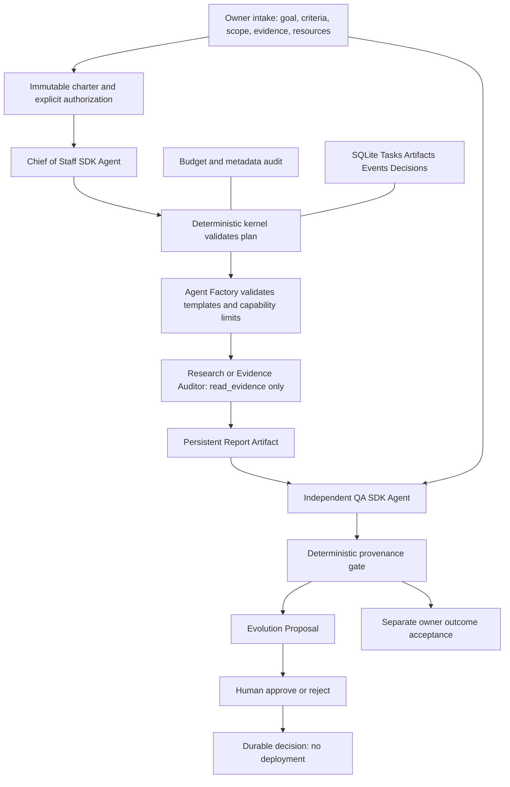

# Architecture · local pilot 0.4

v0.4 adds an external-consumer boundary: a versioned manifest and public SDK/CLI sit above
the existing project service. Consumer projects own their scope, data and state; Porga owns
generic mechanisms. A host-only file adapter supplies bounded immutable evidence snapshots
to the existing restricted tools. No dynamic project code is loaded. The complete implemented
boundary and upgrade rules are in [external contract v1](external-project-contract.zh-CN.md).

This page describes the running local slice. The long-term A1 design is a separate,
reviewable architecture baseline; documenting it does not activate those capabilities.

| A1 design document | Purpose |
|---|---|
| [Target architecture](architecture/target.zh-CN.md) | Five layers, domain boundaries, two closed loops, deployment choices |
| [Domain contracts](architecture/domain-contracts.zh-CN.md) | Objects, invariants, versioning, ports and data migration |
| [Project intake and acceptance](architecture/project-genesis.zh-CN.md) | Startup questions, charter agreement, bounded autonomy and owner acceptance |
| [Execution and governance](architecture/execution-governance.zh-CN.md) | Queue, leases, replay, scheduling, authorization and spend |
| [Evolution and memory](architecture/evolution-memory.zh-CN.md) | Knowledge/Skill promotion, team lifecycle, experiments, release/rollback |
| [External learning](architecture/external-learning.zh-CN.md) | Periodic article/video discovery, traceable distillation and evaluated improvement |
| [Delivery plan](architecture/delivery-plan.zh-CN.md) | M1–M7 dependencies, failure behavior and acceptance evidence |
| [Architecture decisions](architecture/decisions.zh-CN.md) | Choices, tradeoffs, revisit triggers and unresolved owner policies |

## Canonical target layers and current scope

| Layer | Target responsibility | Current v0.3 scope |
|---|---|---|
| L5 Projects & Industry Teams | Industry blueprints and project instances | Charter-governed local projects; no industry blueprint |
| L4 Evolution Engine | Diagnosis, experiments, adoption and rollback | Rule-based proposals and human records only |
| L3 Organization Engine | Chief, dynamic team design and agent lifecycle | Two approved deliverable profiles; registry and pinned organization/graph |
| L2 Kernel | Tasks, policy, memory, budgets, verification and scheduling | Local governance/state; no semantic memory or scheduler |
| L1 Multi-Agent Runtime | Replaceable model and tool execution | OpenAI Agents SDK and offline Model |

Owner authority sits above these layers. The diagram above is the actual local execution
view, not the full target architecture. The earlier Owner/Organization/Execution/Kernel/
Evolution table mixed authority and implementation views and omitted the industry layer.
The original five-layer target is preserved here; future capability is not implied by a
directory name. See [vision](vision.md) and [source reconciliation](design/conversation-audit.zh-CN.md).

The workflow uses code orchestration instead of model-controlled handoffs: each boundary
is validated before the next role runs. Research and QA have separate agents and context;
QA receives the original approved evidence alongside the report. Neither gets write tools.

## Persistence and failures

SQLite transactions keep a task result with its artifact, and a gate with its proposal.
Foreign keys bind persistent records. Events append only through the application, with
minimal metadata. Raw project/report content resides in local state, not event logs.
SHA-256 binds stored artifact content for accidental-change detection. A decision is
atomic and unique per proposal; approvals recheck all run artifact hashes, project hash,
and completed-task linkage before accepting the linked evaluation.

Reservations happen before every model request, including follow-up requests after a
tool call. Usage settles successful requests; failures retain reservations. Budgets are
per run, execution is serial, and the API client does not retry. State remains on handled
failures. v0.2 stores each reservation transactionally, applies a shared daily estimate cap,
and reloads the same budget on resume. Unknown calls remain reserved. An OS file lock spans
the workflow and releases on process exit; a second worker is refused. Cancellation is
cooperative and never promises to undo an already-sent API request.

The task boundary is the checkpoint: completed stage artifacts are reused after integrity
checks. `recover` converts abandoned active state to interrupted without replaying any API
call. `resume` is explicit; incomplete online stages require separate replay authorization.
Automatic retries and in-flight SDK token/turn recovery are deliberately absent.

Additive migrations through user_version=2 preserve old data and create pre-upgrade backups.
SQLite backup/restore uses a consistent snapshot and refuses populated restore targets.
The local operations module is never exposed to model tools.

v0.3's project service persists questions as missing fields derived from the stored charter,
seals approval to its digest, and rejects execution with changed input/mode/excess limits
before model calls. A pending new draft blocks new runs; explicit resume remains pinned to
the original authorized revision. The organization snapshot records definition versions,
capabilities and dependencies; execution remains serial, not a general graph scheduler.
Final owner acceptance is separate from proposal decisions. See [M1 implementation](m1-projects.zh-CN.md).

## Trust boundary

Models cannot access SQLite, approval functions, the host shell, arbitrary file paths,
URLs, GitHub, or key material through tools. The runtime alone holds an API client in
online mode. The operator/OS account remains trusted; this is not an adversarial local
multi-user service. Evidence is data and is never promoted to system instructions.

## Future seams

Replace SQLite with a repository interface/PostgreSQL for multi-host operation, add
authenticated approval sessions, then durable scheduling, scoped connectors, held-out
evaluation, versioned skill promotion, and rollback. Every broader capability requires
a policy change and tests before a model can request it.
