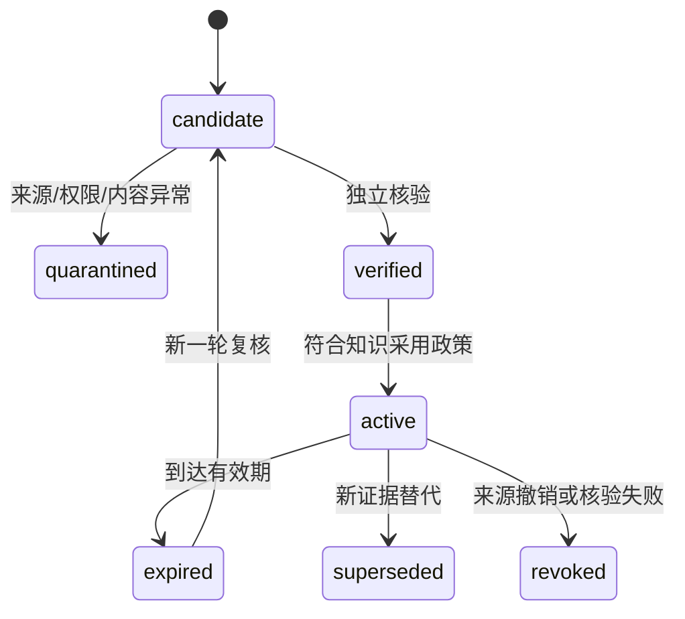
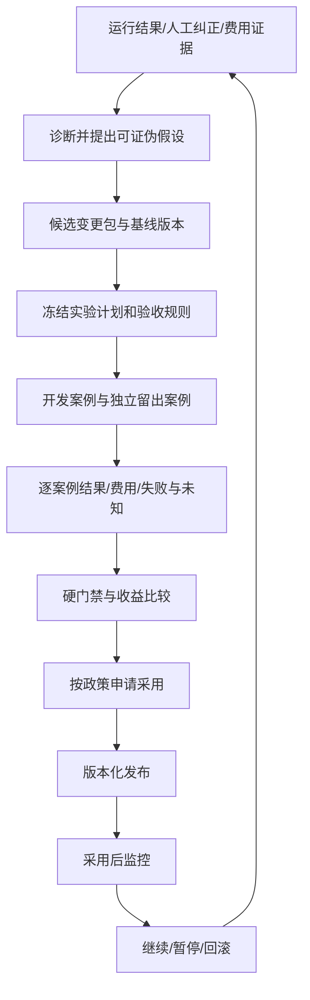

# 知识、Skill、组织演化与受控发布 · A1 设计

设计目标是“经证据选择和保留的改善”，而不是把聊天总结自动转为系统规则。
以下均为待实现流程；v0.2 的固定文案提案与人工决定不具备这些能力。
除内部运行反馈外，外部文章/视频/研究可提供候选方法，详见
[外部发现与蒸馏](external-learning.zh-CN.md)。外部资料进入知识/实验链，不直接改写系统。

## 1. 知识不等于聊天记录

原始材料、可用知识和可执行能力分别管理：

- Raw Artifact：原文、模型输出、检索回执、完整聊天，默认不可信，不自动加入模型系统指令。
- Scoped Knowledge：有来源/验证/适用条件的六类 MemoryRecord，可按授权检索。
- Reusable Capability：评估通过、权限明确、版本固定的 Skill 或 AgentDefinition。

六种知识对象：Evidence（证据）、Fact（核验事实）、Hypothesis（假设）、Decision
（决定及理由）、Skill（可复用方法）、Lesson（适用条件明确的经验）。保留反例与失败，
不让“被模型重复多次”成为高可信度依据。

每条记录包含所属项目/平台范围、敏感度、来源链、验证者/规则、有效时间、适用上下文、
版本、矛盾/撤销关系及依赖它的成果。Fact 是特定条件下的核验结论，不宣称永久真理。

每个读取路径先检查授权、状态和有效时间，再做关键词/向量检索排序。检索命中的
过期事实不能因相关性高而继续成为默认上下文；矛盾信息应并列呈现并触发复核。

## 2. 跨任务与跨项目积累

项目内：任务验证 -> 候选知识 -> 核验/适用性判断 -> 项目知识激活 -> 后续任务受限读取。
平台晋升：从项目经验抽取通用方法 -> 去除项目/个人/商业敏感内容 -> 独立案例验证 ->
访问范围审查与必要授权 -> 平台 Skill/知识新版本。不能仅改变 project_id 就视作脱敏。

MemoryService 的访问策略由 Kernel 执行，存储查询必须带可信 scope。平台知识被项目
复用时记录来源版本；来源被撤销后可定位受影响任务/发布。知识删除、日志保留和法律
要求属于另行的数据政策，A1 不预设真实客户数据已获准进入系统。

## 3. Skill 晋升与可复现包

SkillPackage 包含用途、输入输出 schema、适用/不适用场景、Prompt/声明式步骤、允许
工具引用、资源限制、测试/留出集引用、依赖与内容摘要。初期只接受声明式方法和既有
受限工具，不把“生成一个 Skill”解释成下载/运行任意代码。

状态：draft -> candidate -> evaluated -> approved -> released -> deprecated/revoked。
Skill 晋升不会自动授予工具或数据权限；使用时仍受项目/绑定/任务的权限交集约束。
晋升必须证明与基线相比的收益及无回归，审批引用精确包摘要。后续若支持代码型 Skill，
需单独的代码审查、隔离执行、依赖许可与工具权限流程；不能借现有 Prompt 审批绕过。

## 4. 按目标创建组织

Project Genesis 先输出章程草案、成功标准、业务假设和能力需求，避免先固定职位。
团队规划按以下次序进行：

1. 判断 Chief 自身或现有 Skill 是否足够；不因“可以创建 Agent”就创建新岗位。
2. 查询已验证 Capability/AgentDefinition，优先复用版本固定的能力。
3. 为缺口提出候选定义与用途、工具、预算、输入输出和验收。
4. Kernel 检查能力覆盖、权限交集、验证者独立性、成本与最大团队限制。
5. 候选评估通过后形成 OrganizationRevision，按采用政策激活，再派发任务。
6. 运行反馈用于增减角色和更新候选；不在执行中无记录地改写既有绑定。

近期第一步只在 Owner 批准的角色注册表里动态选取/组合，不开放任意代码生成和新工具。
只有证明该范围内的组队可重复有效，才扩展到定义生成。临时执行者完成即排空；长期
专家有明确晋升/维护/退役依据，避免把所有历史角色都变成常驻成本。

## 5. 拆分、合并和退役的实际语义

| 变更 | 必须说明 | 不能忽略的成本/风险 |
|---|---|---|
| 拆分 | 原职责边界、两个新能力和接口、任务分配 | 交接损失、重复检索、协调成本和权限扩散 |
| 合并 | 重复职责、合并后能力覆盖、原记忆与任务归属 | 单点瓶颈、验证独立性被削弱 |
| 替换 | 缺陷证据、替代版本、兼容与依赖 | 下游 schema/行为回归、费用改变 |
| 暂停/退役 | 无需求/失效证据、运行任务处理、历史保留 | 待办孤儿、旧成果无法追溯 |

组织候选在隔离实验中对同一类任务比较；独立 QA 等职责不能因节省费用而被合并掉。
采用时发布新组织修订，旧任务固定旧版本并排空；历史记忆保留原来源和迁移 lineage。
退役不是删除历史。组织演化失败同样作为 Lesson 保留。

## 6. 首个真实进化实验应当足够小

先做一个研究方法/Prompt 或声明式 Skill 的候选，例如增加证据覆盖检查与不确定性说明，
不要先让系统改自己的 Kernel、授权或评估标准。完整实验流程：

开发集、留出集及规则均有独立版本。候选作者不能选择性删除失败案例或修改通过线；
留出数据不能作为候选的调优上下文。发现泄漏或多次针对同一留出集挑选候选时，冻结
采用并重新建立独立评估。记录候选搜索次数，避免把偶然最优当稳定收益。

质量、来源真实性、权限、安全和兼容性作为硬门禁；在不降低这些门槛的前提下比较
任务成功、费用/延迟、协调与人工依赖。不能通过一个总分把重大回归抵消。
样本量和重复次数依据任务波动与风险预先决定，五个冒烟例子不是统计上的改进证明。
模拟结果只验证链路，不能证明真实模型质量提升。QA 模型的独立上下文也不等于外部事实独立证据。

## 7. 批准、发布、监控和回滚

批准授权精确候选及动作，不直接改活动版本。Release Manager 再核验批准未过期、政策
未撤销、候选/实验摘要一致，并以 compare-and-swap 更新项目的 active_release 指针。
每次发布留存旧版本、兼容性、回退条件与操作者；重复采用事件必须幂等。

运行任务固定 ReleaseManifest。正常更新只影响新任务；权限撤销和严重安全事件可立即
阻止旧任务的后续工具动作。初期只在影子/隔离任务比较，不自动把实验输出写入真实业务；
后续如使用灰度，要明确流量分配、最大损失、退出条件和费用限额。

触发回滚：硬门禁事故、显著质量/成本回归、知识来源撤销或 Owner 决定。流程为停止
新分配 -> 暂停/排空/隔离相关任务 -> 切回兼容的活动版本 -> 对账外部动作 -> 复核知识
依赖 -> 记录事故与后续候选。回滚配置不能撤销已发送邮件、已成交业务或外部付款；
这些能力当前仍未授权，也不能因发布机制存在就获得授权。

## 8. 验证“组织变好了”的指标

分别衡量业务价值、任务质量、协作效率、经济性、自主程度、进化质量和安全性。
Verified Business Value 需要外部可确认成果；Human Dependency 需要记录人工干预与
任务难度/质量条件；Validated Improvement Rate 的分母应包含所有进入正式评估的候选，
不能只统计成功发布。业务效果往往有滞后，应保留归因条件而不把相关性写成因果结论。

八维递进分别建立证据：认知看预测/事实反馈，记忆看有效性和复用，能力看独立案例，
效率看同等质量下资源，协作看端到端结果，组织看拓扑对照，决策看后续结果，创新看
独立实验。只有证据覆盖的维度才可报告提升，不用“自主率”掩盖未经核验的自动行为。

## 9. 0.8 首次改进的验收草案

候选示例是一份证据审查清单，在综合结论前标记每条来源的覆盖与不确定性。
基线使用已冻结的方法版本，候选只改这份清单。两组使用同一批允许的来源、模型配置、
验证规则和资源上限。预先写清希望减少的缺陷、可接受成本、样本量与重复次数；
在每案权限、出处及安全硬门禁通过后，再比较遗漏、人工纠正、调用数和延迟。

| 用例 | 测试动作 | 通过条件 |
|---|---|---|
| I08-01 冻结实验 | 在运行前记录基线/候选、数据版本与分组、指标、阈值、预算和停止条件 | 生成独立计划摘要；候选看不到留出集，且无法修改判定规则或筛去失败案例 |
| I08-02 对照与拒绝 | 保存全部案例结果，加入缺来源、越权或留出集泄漏的负例 | 任一硬门禁失败阻止采用；不足或未知有明确结论，费用与失败计入记录 |
| I08-03 审批后变化 | 审批后替换候选内容、实验摘要或适用政策 | 执行前重新校验并拒绝过期或不匹配的批准，活动版本保持原状 |
| I08-04 独立采用 | Owner 审阅后先记录批准，再明确触发采用；重复提交采用动作 | 批准记录独立可见；有效动作只切换一次活动代际，新任务绑定新版本，旧任务保留原绑定 |
| I08-05 回滚演练 | 模拟采用后硬门禁失败或出现显著回归 | 停止新分配，切回兼容版本，核对待处理任务、费用和副作用，留存事故及回滚证据 |

验证记录应包含冻结计划摘要、全部案例、采用审批、发布前后活动版本以及回滚后的
首个任务绑定。离线 fixture 可以证明状态与门禁，真实能力改进结论还需要代表性任务的
独立对照结果。这里的采用指项目运行配置的激活；官方代码发行遵循仓库 Owner 的发布治理。

## 10. 0.9 组织演化与领域复用的验收草案

选一个有观测证据的组织问题。例如证据核查与报告汇总存在重复工作，可比较拆分、
替换或维持原角色。比较前冻结原组织与候选组织的定义、任务图、数据/权限、费用上限、
独立 QA 和验收指标。记录协调开销及人工介入；保留不改善和不适用的结果。

| 用例 | 测试动作 | 通过条件 |
|---|---|---|
| O09-01 拆分 | 把复合职责拆成两个有明确接口的角色，在同一组任务上与基线对照 | 职责和交接可追踪，权限和预算未扩大，所声明的质量或效率收益有证据 |
| O09-02 合并拒绝 | 提议把独立验证并入被验证的执行角色 | 候选无法激活，能查到独立性约束和拒绝原因 |
| O09-03 替换/退役 | 有待办、在途任务和历史成果时切换版本或退役旧角色 | 新任务只绑定有效版本；旧任务有排空、暂停或明确迁移决定，历史依赖仍可定位 |
| O09-04 组织回退 | 在候选激活后注入不兼容输出或质量下降 | 通过已验证的采用/回滚流程恢复兼容组织，保留全部原任务和组织记录 |
| O09-05 领域隔离 | 在同一内核运行两个独立合成模板，例如技术方案对比和事件记录核查 | 两者分别提供输入、职责和领域验收，互不读取状态或授权；内核无针对某个模板的特例 |

M5 需要对实际候选给出独立对照证据。M6 的最小合成交付还要能把来源、假设、结果和
后续任务连成可追溯反馈。模板可提前准备，组织改善结论依赖 M4/M5 的验证与采用记录。
