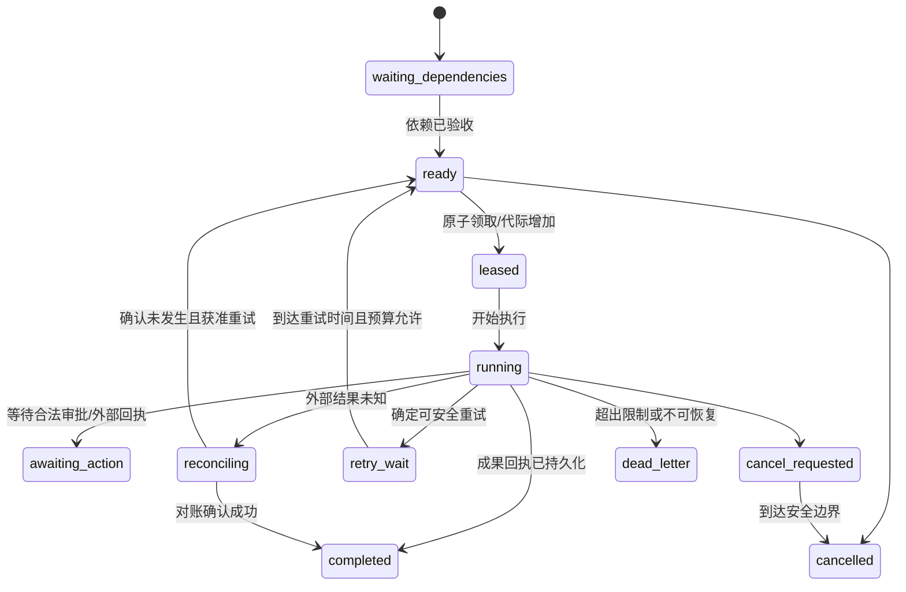

# 持续执行、权限和费用治理 · A1 设计

这是目标设计。v0.2 的整库 OS 锁和人工恢复继续有效；本文件没有启用后台服务或新的权限。

## 1. 从一次 CLI 到持久工作流

目标调度链：事件/定时触发 -> 命令校验 -> TaskGraph -> 事务 Outbox -> 可重复投递 ->
Worker 领取 -> 权限/费用预留 -> SDK/工具执行 -> 成果和回执 -> 独立验证 -> 下一阶段。

先支持一个本地 Worker，以有限状态机和数据库事务保证可恢复。只有租约、幂等、预算
与冲突写入测试通过，才解除当前整库执行锁，允许有限并发。不能直接删除锁来“支持多 Agent”。

### 任务状态和领取

完成任务与验收成果分开；下游需要的依赖状态由 acceptance_spec 指定。
同一逻辑任务可有多个 Attempt，所有失败和未知结果保留，不覆盖历史。

### 租约与僵尸 Worker

领取事务写入 worker_id、lease_expiry、fencing_token，并创建 Attempt。心跳只能由
当前代际持有者续期。领取、写成果、推进状态和提交费用回执均检查代际；过期 Worker
即使恢复网络也不能覆盖新持有者。外部动作已经发生时，代际检查只能保护本地状态，
仍需工具幂等或对账确认，不能承诺阻止所有外部重复动作。

## 2. 交付语义与副作用

内部事件按“至少一次”投递设计：事件可重复，消费者幂等。用唯一 event_id、inbox
消费记录、命令指纹和数据库唯一约束去重。不要宣称跨数据库与外部 API 实现 exactly-once。

| 动作 | 失败处理 | 自动重试条件 |
|---|---|---|
| 本地纯计算/受限读取 | 保留 Attempt，有限退避 | 输入版本未变、预算和政策允许 |
| 模型推理 | 可能已经计费；保留未知预留 | 可确认请求状态或已有明确重发授权 |
| 支持幂等键的外部写入 | 复用稳定动作 ID，读取服务回执 | 对方明确提供可依赖的幂等语义且策略允许 |
| 不支持幂等的外部写入 | 进入 reconciling，禁止盲目重发 | 确认未执行或人工决定承担重复风险 |
| 不可逆/高风险动作 | 最低权限、独立审批与动作回执 | 不因一个超时错误就自动重做 |

当前范围继续禁止外部写入、支付、生产访问和任意 shell。表格是未来工具接入规则，
不是今天允许这些动作。补偿动作同样需要权限，且不能将“补偿”描述成现实结果已被撤销。

## 3. Scheduler、事件监听与 24 小时目标

Scheduler 持久保存 schedule_id/version、项目、触发规则/时区、next_fire_at、错过触发策略、
每周期/每日资源限制、停止条件和通知规则。定时事件 ID 由 schedule/version/计划时点确定，
重启或重复轮询不能重复创建同一轮任务。

错过触发需要显式 skip、coalesce 或受限 catch-up，不能在电脑开机时无限补跑历史周期。
时间窗口内相同外部事件去重，错误输入进入隔离队列，连续失败触发熔断和人工升级。

本地守护 Worker 只能在电脑开机、进程运行且必要网络可用时服务。真正与个人电脑无关的
持续运行需常驻服务器、监控与恢复演练；模型仅在收到有价值工作时调用。

## 4. 权限模型和审批

实际授权 = 平台政策 ∩ Workspace 政策 ∩ Project Charter ∩ AgentBinding ∩ Task/Action 范围。
Tool Gateway 从可信执行上下文取得主体和项目，不使用模型输出的 actor/project 字段鉴权。
凭据由本地 OS/未来密钥服务管理，模型只能请求具名能力，不能读取明文令牌。

| 原讨论自治级别 | 目标政策 | 什么时候需要人 |
|---|---|---|
| L1 观察 | 已授权数据范围内的读取/分析 | 新数据范围或异常 |
| L2 执行 | 已批准任务图和预算内的受限动作 | 越权、未知副作用、停止条件触发 |
| L3 进化 | 候选/离线实验可预授权；采用另过门禁 | 新权限/工具、评估规则变更或未授权采用 |
| L4 经营 | 仅明确列出的业务动作和资源限额 | 未列出动作、风险/额度超限 |
| L5 重大决定 | 最终目标、资金/负债、关键授权等 | 必须由所有者决定 |

L1–L5 是目标分级，不是 Agent 自行判断后可升级的权限。当前每次提案均需人工决定且
不部署；未来低风险自动采用需所有者预先批准 Policy 版本，并由独立的确定性门禁执行。
同一个候选生成者不能修改自己的评估/放行规则。政策变更本身禁止由该进化链自动采用。

ApprovalRecord 绑定 subject_digest、实验结果/评估集摘要、policy_version、动作/资源范围、
批准者、有效期和撤销状态。候选、数据范围或策略变化使旧批准失效；重复事件不能导致
重复发布。当前本地 actor 标签不等于多人身份认证，不能据此推出服务器权限已安全。

## 5. 费用、配额和背压

费用账本为追加记录：reservation -> settled/unknown -> reconciliation adjustment。
模型费用、工具费用、实验费用都按动作记录；更正不删除原记录。原执行价格快照留存，
提供方账单和本地估算明确区分。预算不能被同一 Agent 的提案自动提高。

限制同时覆盖 Workspace/项目/日/任务/实验/提供方；在一个事务内检查并预留。明确租约
重领不会重新初始化预算；失败和未知预留也计入可支出余额。新的数据目录或独立服务端
不能冒充同一个全账户限额，需要所有者统一治理。

并发令牌、每分钟请求/Token 配额、队列长度/年龄、任务优先级与保留的审批/取消通道
共同控制背压。资源耗尽时排队/降级/停止，不靠无限重试维持“自主”。指标需区分真实
用量、预留、未知与模拟用量，mock 结果不能计为模型业务产能。

## 6. 运行停止、故障与告警

| 故障 | 目标行为 | 必须能证明的结果 |
|---|---|---|
| 持久化前进程崩溃 | 检查外部动作状态，按回执恢复 | 不因无本地回执就断言动作未发生 |
| 领取后 Worker 消失 | 租约到期/代际更新 | 旧代际无法提交成果 |
| 收到重复事件 | inbox/指纹去重 | 不增加逻辑任务、发布或工具动作 |
| 审批后候选被更改 | digest 校验拒绝 | 不执行未经审阅的内容 |
| 验证器不可用 | 停留待验/隔离 | 不通过跳过验证继续采用 |
| 资料过期/撤销 | 阻止新使用并追踪依赖 | 可找到受影响成果和发布 |
| 发布异常 | 暂停新任务、回退活动指针、对账 | 旧任务/外部副作用有明确处理报告 |
| 磁盘/数据库/备份错误 | 安全停止写入/采用，告警并演练恢复 | 不把日志缺失当正常完成 |

通知只在所需决策、重要状态变化、预算/安全/服务异常及约定复盘时发送。日报/复盘的
频率由 Owner 决定，不自动创建用户未要求的定时消息或自动化。

## 7. 0.6 入口权限与故障验收草案

MCP 首先包装已经稳定的应用服务，调用方身份及项目范围从可信会话或宿主绑定取得。
表中是行为范围，工具名与错误码随实现定义。短任务入口可以先验收；宣称断线后继续
或提供后台任务前，需要单独通过 M2 的持久执行验收。

| 操作 | SDK/CLI 与 MCP 共用的检查 | MCP 首批权限 |
|---|---|---|
| 预览 | 当前项目、显式来源、范围及输出边界 | 只读获准范围；返回必要信息，完整证据另经访问检查 |
| 提交 | 精确章程授权、版本、幂等键、输入指纹、预算 | 只提交已授权任务，绑定与调用状态可审计 |
| 查询/读取成果 | 任务与当前项目匹配；成果通过同一访问策略 | 可读允许返回的结果；导出到磁盘或其他系统走明确操作和权限 |
| 请求取消 | 调用者具有该任务的取消权；持久记录请求 | 返回当前状态，实际停止由 Worker 在安全边界确认 |
| 授权、接受成果、增额、发布 | 可信 Owner 动作与精确对象 | 不注册为模型工具 |

| 用例 | 故障注入或重复动作 | 通过条件 |
|---|---|---|
| E06-01 入口一致 | 通过 SDK/CLI/MCP 提交同一授权和请求键，再以该键提交不同内容 | 相同请求定位同一任务；不同指纹拒绝；越权请求不泄露其他项目的任务或成果 |
| E06-02 写入与投递 | 在任务与 Outbox 提交前终止，再在提交后、确认投递前终止 | 事务前无可领任务；事务后可恢复投递，重复消费只推进一次逻辑任务 |
| E06-03 领取失效 | 领取后终止 Worker，租约过期重领，注入旧代际回执 | 尝试历史保留；旧代际无法提交成果、推进状态或结算新尝试 |
| E06-04 未知副作用 | 发送模拟请求后、保存回执前终止 | 进入对账并保留费用预留；经确认后才恢复或重试，记录依据 |
| E06-05 成果写入 | 保存成果后、状态推进前终止，再投递完成事件 | 按成果和回执恢复；下游只使用一次已验收成果，缺证据时保持待验 |
| E06-06 断开与取消 | 断开调用端后用相同键查询或提交，随后发取消请求 | 能查清提交是否持久化；已受理的后台任务以服务端状态为准；取消后无新增调用 |
| E06-07 定时重启 | 重复投递同一计划时点，再模拟错过多个时点 | 同一轮只生成一次；严格执行约定的跳过、合并或有限补跑策略 |
| E06-08 费用和拒绝 | 预算用尽、章程失效或验证器故障 | 不启动额外请求或跳过验证；已有预留和审计记录可检查 |

使用合成任务和模拟回执，逐案保留输入指纹、任务/尝试/事件 ID、注入点、状态转换和
预留/结算差异。E06-01 的入口语义可先验收；E06-02 至 E06-08 中依赖 M2 的部分
需要持久执行实现后再跑。取消前已发出的请求仍按回执或未知状态处理。
