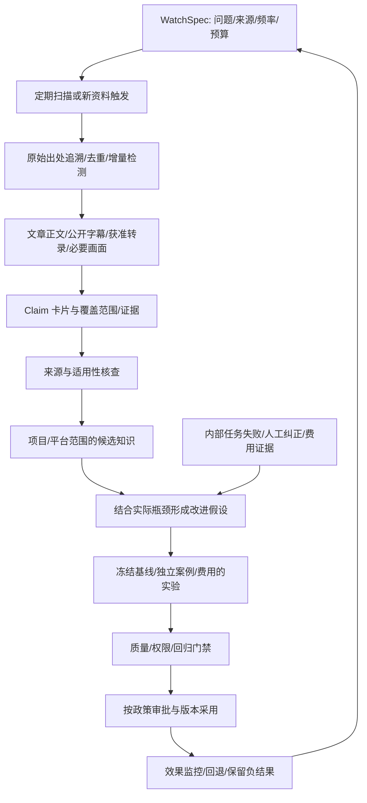

# 外部发现、蒸馏与进化反馈 · A1 设计补充

状态：待实现的外部学习机制。v0.2 没有周期搜索、视频转录、联网 Research 工具或自动采用能力。
本设计不创建 Codex 自动化、不启用定时任务，也不授予付费 API 或自动改代码权限。

## 1. 外部学习补充哪条闭环

Porga 同时需要内部运行反馈和外部方法发现。内部结果告诉系统哪里有问题，外部资料
提供可能的解释与新方法；二者结合才形成适合 Porga 的改进假设。没有内部需求的外部
热点可以保留为参考，不必自动创建实验或扩张角色。

资料被发现、内容被总结、某条主张被核验、实验通过和版本采用，是不同的状态。
不得把搜索数量、收藏数量或生成报告数量作为系统已经进化的证据。

## 2. 谁学习什么

- Porga 自身：组织、治理、验证、调度、知识/Skill 方法与实现技术的改进。
- 项目领域：某个项目获准研究的业务资料、市场假设或工作方法。

项目 Agent 可以提出通用平台改进候选，但不能直接修改 Porga Kernel。跨项目通用晋升
必须检查来源权限、敏感信息和适用性；一个项目的资料授权不等于全平台可复用。

学习职责包括 Scout（发现）、Distiller（结构化蒸馏）、Verifier（核验）、Experimenter
（设计实验）。这是职责划分，不要求固定创建四个常驻 Agent；按任务需求复用既有能力，
独立核验与候选生成不能变成同一个自我打分步骤。

## 3. ResearchWatchSpec：先限定学习问题

应明确目标问题、关键词/主题、优先来源与作者、允许媒体/语言、项目范围、频率/时区、
每轮链接数/阅读时长/Token/费用、最大实验数、过期规则、停止条件和通知政策。
不能把“自主学习”解释为无限抓取全网、无限调用模型或自动执行检索到的脚本。

建议起步策略（待 Owner 配置，不自动启用）：每周一次增量发现与筛选，每月一个有
明确价值的候选实验；官方版本变化、已知问题或 Owner 提供链接可触发额外的受限学习。
频率服从需求与预算，重要更新可以优先处理，重复转载不重复付费精读。

长期调度接入既有 Scheduler/队列/预算设计；不要再建一个独立、无配额的无限学习循环。
本地进程和网络不可用时保存待办，恢复后按 skip/coalesce/受限 catch-up 策略处理。

## 4. 发现、去重与可信来源

来源可包含官方文档/发布说明、作者原文、论文、公开代码和许可允许的文章/播客/视频。
二手摘要只作线索，优先回到原作者/原始演示。作者知名度可影响排序，不能代替证据。
主动寻找反例、失败经验、适用条件和费用，避免只学习成功故事。

每条 SourceRecord 记录原始 URL、规范 URL、作者/发布者、发布/访问日期、版本、内容
摘要/哈希、访问方式、授权/许可边界、媒体类型、首次/上次见到、原始出处和转载关系。
多篇转载同一演讲不算多份独立证据。资料变更/撤回后标记依赖它的知识、实验与发布。

联网 Connector 仅做受限读取；校验协议、域名/IP、重定向、文件类型/大小、超时和
下载上限，阻止探测本机/内网、携带凭据或因页面脚本发起额外动作。网络文本、字幕、
评论和下载内容均不可信，不能变成系统指令，也不能覆盖 AGENTS.md 或现有政策。

## 5. 文章与视频如何蒸馏

| 媒体 | 可采用的证据 | 必须报告的缺口 |
|---|---|---|
| 文章/文档 | 原文段落定位、作者/版本、必要少量引用 | 仅摘要/标题可见、版本不明、未取得正文 |
| 视频/播客字幕 | 作者/平台公开字幕或获准转录、时间范围、语言/置信度 | 自动字幕误识、缺失段落、无法验证画面 |
| 演示画面 | 获准查看的片段、时间戳与操作前后状态 | 仅口述不能证明演示成功，剪辑可能省略条件 |
| 官方代码/发布说明 | 对应版本、文件/提交/许可和测试 | 主分支更新不能代表视频当时版本 |
| 二手解读/转载 | 找到原始出处的线索 | 未回到一手材料时不得升级为已核验主张 |

对视频不得只看标题就报告看完。ContentCoverage 分开记录已读页面、目录、完整/部分
逐字稿、音频和实际画面片段。对于依赖画面的主张，字幕本身不足以验证。
无法访问、需要登录或缺少授权时记录缺口，不绕过访问限制。

完整第三方视频/文章不默认复制到 Git；保留来源指针、必要摘要和许可允许的证据。
转录服务若付费或会向外部发送内容，先满足资料授权与费用政策。原始缓存按保留政策
存于本地 Artifact Store；公开仓库只放可公开的知识卡片与自己的分析。

## 6. 从内容到可测试假设

DistillationBrief 至少区分：原作者主张、已观察事实、作者自述结果、我们的解释、
适用环境、前置投入、费用/风险、证据不足与对 Porga 的可能价值。翻译和 ASR 不确定性保留。

ClaimRecord 引用具体段落/时间范围，并给出核验状态；不得只给整页 URL 就断言所有细节
都有支持。引用准确也不等于主张真实，单个演示/产出数字不能证明可普遍复现。

每个 ImprovementHypothesis 绑定 Porga 需求/瓶颈、基线版本、建议差异、可测预期、
反例、实验预算和停止条件。例如学习“验证方法先行”后，实验可以检查独立验证是否
减少漏检与人工返工，而不是把外部案例的 PR 数量设成 Porga 的成功目标。

## 7. 三种采用路径与边界

| 产物 | 可进入哪里 | 采用条件 |
|---|---|---|
| 参考知识/事实假设 | 有范围、来源、有效期的 MemoryRecord | 核验和知识采用政策；不自动变成执行指令 |
| Prompt/声明式 Skill/组织方法候选 | 候选注册与实验区 | 独立案例、费用/质量/安全/兼容门禁，按政策批准发布 |
| Kernel/策略/预算/评估器/工具权限/代码变更建议 | 单独工程与所有者治理流程 | 精确变更审阅、必要代码/依赖验证；不由外部学习链自动自改 |

新知识不能自动提高权限。外部推荐的代码、账号连接方式、自动合并政策或昂贵执行规模，
都不能继承为 Porga 的授权。低风险自动采用如需开放，必须有明确 Owner 预授权的政策版本，
验证者与被测候选隔离，保留版本和回滚；当前 v0.2 继续只记录人工决定、不部署。

## 8. 与 M2/M3/M4 衔接

- M2：持久触发、增量扫描、队列、配额、取消与幂等；没有守护进程时不宣称定期运行。
- M3：SourceRecord、ContentCoverage、ClaimRecord、DistillationBrief 的范围/溯源与知识晋升。
- M4：ImprovementHypothesis 接既有 ExperimentPlan/Result、Approval 与 Release，而非另开自批准通道。

验收至少覆盖重复转载/来源变更、视频仅目录可见、ASR 错误、对立证据、网页提示注入、
预算不足、缺少权限、无法重现以及评估集泄漏。不得因资料说“自动合并”就跳过现有发布门禁。

学习效果看：可追溯有效发现、候选与真实瓶颈的关联、实验可复现率、被采纳后的质量/费用/
人工依赖变化和负结果保留。没有新证据或有用候选时可以输出“本轮无需变更”。

## 9. 最小实例与当前状态

首个示例线索为 [Lauren Tan 工作流资料卡](../research/lauren-tan-workflow-source-card.zh-CN.md)。
它演示来源层级、内容覆盖和候选分析，不是 Porga 已自主联网学习或已证明改善的运行记录。
目前的资料核验由本次开发对话辅助完成，周期执行、转录、自动实验与采用仍待实现。
