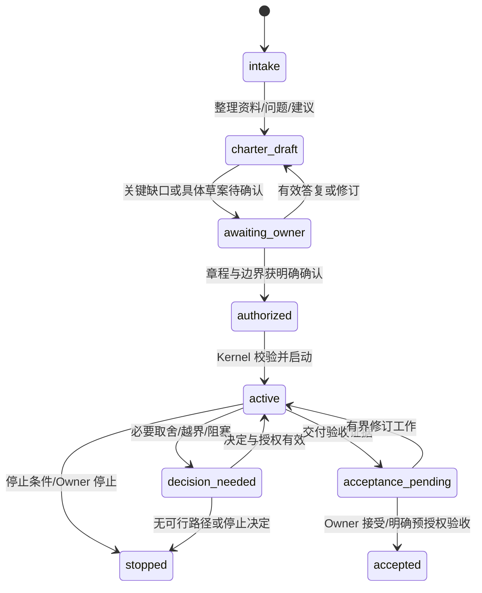

# 项目启动、授权与目标验收 · A1 设计补充

状态：目标交互与领域协议设计，尚未成为 v0.2 的启动功能。当前运行仍需手工提供目标和证据。

## 1. 核心原则

Porga 接手项目前要建立共同认可的项目章程。Owner 决定想达到什么、怎样才算满意、
允许承担什么成本和风险；Chief 负责理解已有资料、提出可审阅的默认方案、组织和执行。
尽量减少重复提问与过程微管理，不以沉默、长时间未回复或一次笼统授权代替具体许可。

启动澄清不是一次性完成后永不检查：后续只针对重要新信息、真实冲突、越界请求或
必须取舍的决定补问，不反复询问已经明确且仍然适用的事项。

## 2. 先理解，再集中询问

流程：自然语言目标 -> 读取已授权项目资料/适用偏好 -> 列出已知与关键缺口 ->
给出章程草案和建议 -> 集中确认少量关键问题 -> 确认精确章程 -> 形成团队与计划。

每个字段记录状态与来源：Owner 明确确认、已有有效授权、系统建议、可逆假设、未知。
不能把助手建议、原始聊天、别的项目的授权或过期偏好变成新项目的已确认事实。
重复使用资料时仍须满足项目访问范围。

首轮通常聚焦 3–5 个最影响方向/资源/风险的问题，并提供建议选项与影响；资料已经
覆盖的字段不再询问。这个数量是交互目标，不是允许省略关键授权的硬上限。
Owner 可以先只描述目标；Chief 应协助构造选项，不要求 Owner 先写完整项目管理文档。

## 3. 启动时应确认的内容

| 类别 | 需要理解的问题 | 如何减少人的负担 |
|---|---|---|
| 最终成果 | 服务谁、解决什么问题，要交付什么可使用成果 | 把宽泛愿望改写成建议成果，请 Owner 修正 |
| 成功与满意标准 | 哪些可测结果、必要条件、偏好和反例决定验收 | 给出量化指标/检查项和样例，不自行认定“你满意” |
| 范围与非目标 | 做哪些、不做哪些；当前阶段与外部依赖 | 提出最小可验证范围，标出排除项与假设 |
| 资源与期限 | 总/日/实验费用、时间窗口、可用资产、停止损失 | 提供小步试验方案；没有付费授权时不调用收费能力 |
| 权限边界 | 哪些可自主读/写/调用工具；哪些外部动作必须批准 | 默认最小权限；角色/技术细节由系统在已批准能力内选择 |
| 数据边界 | 可用来源、隐私/商业敏感性、跨项目复用和保留 | 复用已批准资料范围，不让模型猜测数据使用权 |
| 优先级与取舍 | 正确性、成本、速度、体验等冲突时哪个优先 | 只呈现会影响结果的取舍，不把实现细节全部交给人 |
| 自治与进化 | 可实验/调整哪些方法，实验预算，谁批准采用 | 预先约定低风险范围；不把进化理解为可提高自身权限 |
| 沟通与升级 | 何时汇报、什么事件必须打断、等不到回复怎么办 | 聚合里程碑和异常；没有回复时暂停依赖批准的动作 |
| 验收与退出 | 谁接受结果、怎样处理部分达成/不可行、何时停止 | 里程碑先校准样例；停止条件和最终人工认可可追溯 |

安全边界、支出权限、不可逆动作、实质目标和验收规则不能凭默认猜测后执行。
已获授权范围内的低风险可逆细节可以采用明确记录的假设，后续按证据修正。
可在关键缺口未补齐时进行不依赖这些许可的已授权分析，但不宣布正式接管或完整启动。

## 4. Project Charter 应是什么

章程不是长篇介绍，而是可用于校验工作的约定：

- goal/outcomes：目标、受益者、成果及非目标。
- acceptance_criteria：可验证条件、必要门槛、偏好/反例、证据与最终接受者。
- constraints：期限、费用、风险、数据/工具/外部动作边界。
- autonomy_policy：允许的观察/执行/实验/采用范围及强制升级条件。
- milestones：阶段结果、小样校准与复盘窗口。
- assumptions/open_questions：假设、待决项、来源、影响与阻塞的具体分支。
- stop_conditions：预算、风险、连续失败、证据不足、不可行或 Owner 停止。
- revision/approval：精确内容摘要、适用政策与 Owner 决定；重大变更要有新版本。

Owner 审阅并确认具体草案后才在其范围内运行。不能让 Owner 审批一句“请全权接管”，
却把未呈现的预算、数据访问、自动发布或经营动作藏在系统内部。

## 5. 目标验证与最终认可

把“达到我认可的目标”拆成三类：客观可验条件、需要判断的偏好、受外部环境影响的成果。
客观条件由独立验证和证据检查；主观偏好通过早期小样与 Owner 反馈校准；外部成果
要保留观察时间、归因和不确定性，不将模型生成的推演当作现实结果。

阶段性样例有助于减少最终返工，但不能偷偷改变原验收线。Owner 更改目标/优先级时
形成新的 CharterRevision，记录原因及对旧计划的影响。Chief 不能为了通过验收而
自行降低标准，也不能在没有可行路径时无限花费资源重试。

系统可以证明已满足约定的自动验收项并提交接受请求；只有明确的 Owner 接受记录，
才能报告“Owner 已认可”。如果 Owner 事先明确批准某类客观成果自动验收，则按该
具体政策记录“预授权验收通过”，不伪造新发生的人工认可。

## 6. 减少人工参与的运行方式

Owner 原则上只参与目标/边界确认、必要取舍和最终接受。已授权的任务拆解、角色选择、
检索分析、验证、有限重试和低风险实验由系统承担。关键动作均有可查询记录，日常只
发送约定的里程碑或异常摘要，不让 Owner 审批每一条内部思考/普通工具读取。

进化采用仍按既有治理设计：生成候选 -> 冻结验收 -> 独立对照 -> 政策判断 -> 必要审批
-> 发布 -> 监控/回退。未来可以由 Owner 预授权特定低风险采用，但当前 v0.2 不具备
该机制，不能因为项目启动时表达了“少参与”就自动启用。

进化可以改善方法、Skill、协作与团队；不能自行改变最终目标、验收标准、预算上限、
数据范围或治理权限。系统应分别报告成果进展、方法改善证据和仍需人决定的事项。

## 7. 哪些情况才打断 Owner

| 情况 | 系统先做什么 | 必须保留的边界 |
|---|---|---|
| 授权内的普通执行问题 | 有限重试、切换已批准方法、保留证据 | 不增加预算/权限、不绕过验证 |
| 偏好不清但动作可逆且低风险 | 按已确认优先级提出并记录假设 | 可撤回，不能隐藏对验收的实质影响 |
| 目标/标准冲突或需要业务取舍 | 汇总选项、推荐、影响与所需决定 | 只暂停依赖该决定的分支 |
| 新权限、数据范围、外部写入或增加支出 | 请求具体审批 | 等不到回复不是批准 |
| 高风险、来源失效、异常费用或未知副作用 | 停止相关动作、隔离/对账、必要告警 | 不继续追求表面完成率 |
| 预算/截止/连续失败/不可行条件触发 | 给出证据、剩余差距、可选路径与停止建议 | 不保证一定成功、不无限迭代 |

决策请求使用一张简明卡片：现在发生什么、为什么不能自行处理、有哪些选项、推荐什么、
成本/风险/目标影响是什么、需要你决定什么、等待期间哪些已授权工作可以继续。
不得使用未经批准的通知渠道或替用户创建新的定时消息。

## 8. 启动状态机与持久对象

新增草案对象：IntakeSession（已知/未知与适用来源）、QuestionBatch（仅未解决的关键项）、
CharterRevision、OwnerDecision、EscalationRecord、AcceptanceRecord。它们与 Task、
ApprovalRecord、ReleaseManifest 分开：认可项目目标不等于批准每次发布，批准一次发布
不等于接受最终业务成果。拒绝/撤销/新证据要有明确状态转换，不靠删除旧记录来纠错。

## 9. 纳入 M1/M2/M4 的验收要求

- 已有有效答案时不重复询问；不同项目授权不相互继承。
- 关键目标/费用/权限/数据缺口阻止依赖它们的启动；可独立的已授权分析仍可继续。
- 对每个验收项能定位到证据、验证版本或 Owner 判断；模型自评不能替代 Owner 接受。
- 未回复、超时和笼统意愿不会自动授权；章程重大变化使关联批准/计划重新校验。
- 已授权低风险工作不要求逐步确认；必要取舍以合并决策请求呈现。
- 候选改进不能通过修改目标/门槛、增额或越权来提高通过率。
- 目标不可行或条件触发时，停止并报告差距；不能承诺一定达到任何业务目标。

这些检查是未来项目创生实现的验收，不是新增一个提示词就完成。软件实现仍按
[交付计划](delivery-plan.zh-CN.md) 推进，当前尚未具备本文件的完整交互与自治能力。

## 10. 0.5 团队选择与复用用例

输入为版本固定的章程、交付类型、预算和受审注册表。Chief 提出能力需求与候选理由，
Kernel 依据实际权限、能力覆盖、验证独立性和预算逐项校验。复用对象是固定版本的定义
或 Skill，每次绑定都重新检查该项目的范围和权限。

| 用例 | 输入 | 预期决定与留存证据 |
|---|---|---|
| O05-01 任务适配 | 两份合成章程，分别要求综合研究与逐来源证据核查 | 选择不同的合法团队或任务图，快照列明能力需求、定义版本、依赖、独立验证者和理由 |
| O05-02 定义复用 | 注册表中已有满足要求的有效定义 | 使用固定版本，记录复用理由，按本项目授权重新绑定；历史状态和授权与原项目隔离 |
| O05-03 能力不足 | 目标依赖注册表没有的能力、被停用的版本或未批准工具 | 返回具体能力缺口和受影响任务；候选停留待审，未启动执行角色或其工具 |
| O05-04 计划违规 | 候选缺独立 QA、包含循环依赖或超过预算 | 拒绝激活，审计记录可定位失败规则；调用方不能用默认团队绕过 |
| O05-05 修订竞态 | Owner 审阅后修改目标、资料或预算 | 新执行按最新有效章程与授权校验；旧任务仍可查询其原快照 |

对相同批准输入和相同候选，校验判定应一致。若多次生成的候选不同，分别保存实际
候选与选择理由，以同一规则检查它们，而非要求模型逐字重现。
