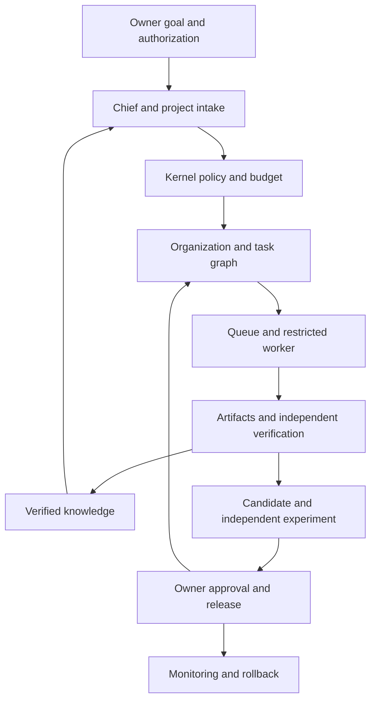

# A1 Target Architecture

A1 describes planned capabilities. The [implementation architecture](../architecture.md) describes the local 0.4 pilot. Initial acceptance uses public or synthetic evidence and a single trusted owner.

Porga has two connected loops. Project work proceeds from the goal and charter through team selection, tasks, evidence, and acceptance. Organizational improvement proceeds from run evidence through a candidate, independent evaluation, explicit authorization, activation, monitoring, and rollback. A proposal or a human decision alone does not demonstrate improvement.

| Layer | Responsibility |
|---|---|
| L5 Projects and Industry Teams | Project instances, domain templates, and domain acceptance. |
| L4 Evolution Engine | Diagnose, propose, evaluate, adopt, and roll back changes. |
| L3 Organization Engine | Chief, capability registry, organization planning, and agent lifecycle. |
| L2 Kernel | Deterministic policy, budget, authorization, tasks, storage, verification, and audit. |
| L1 Multi-Agent Runtime | Model and SDK adapters, restricted tools, and usage receipts. |

The owner controls purpose, access, spending, and acceptance. Models submit typed requests and cannot acquire credentials, unrestricted tools, or control over their evaluators. Each run pins its organization, policy, evidence, and release. Unknown external results go through reconciliation. Knowledge promotion requires provenance, scope, and verification.

Start with a modular Python application. The management plane owns approved goals and revisions. The execution plane consumes pinned execution specifications. Modules communicate through application services and repository interfaces. Domain rules remain in project templates. See [domain contracts](domain-contracts.md) and [project intake](project-genesis.md).

Local transactions bind state changes, audit events, and Outbox records. Consumers use stable event IDs, revisions, and receipts. SQLite is a local single-host store. A separate multi-host design may use a server database and object storage. Evaluate Temporal or another durable engine only when workflow complexity justifies it. The OpenAI Agents SDK runs model and tool loops; Porga owns the application boundaries.

Keep metadata and trace correlation separate from sensitive content. An operator should be able to locate blocked work, spending and reservations, expiring evidence, effective versions, and approval or rollback decisions. Validate capabilities using the [delivery plan](delivery-plan.md) and the [external learning design](external-learning.md).
