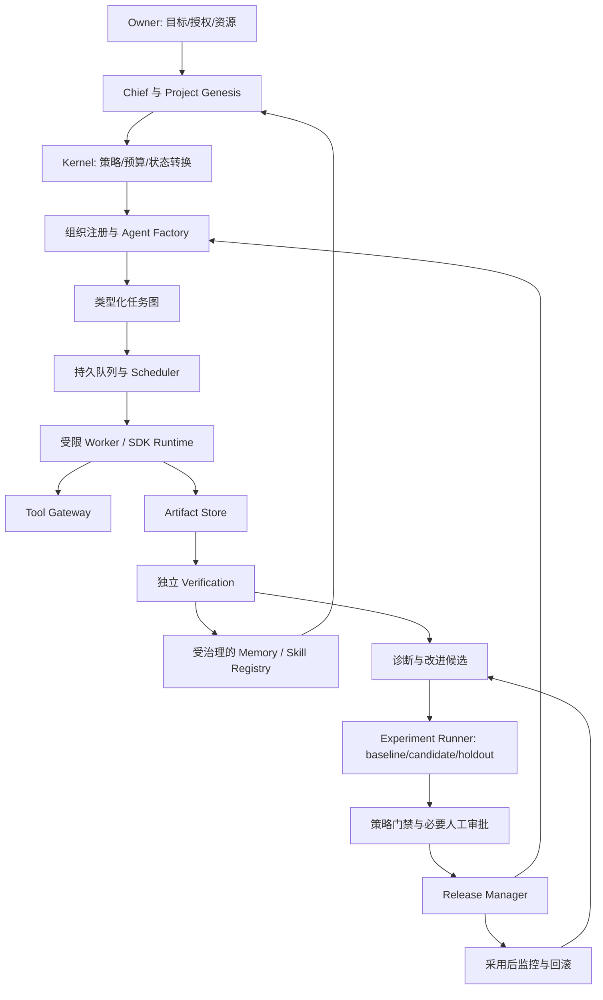
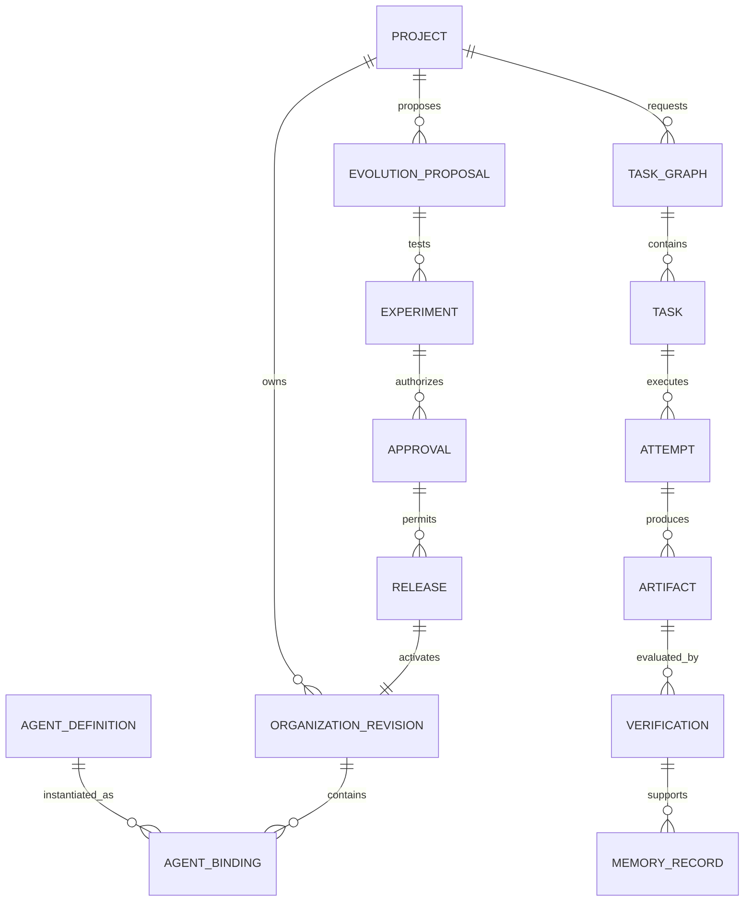

# Porga 长期目标架构 · A1 设计基线

日期：2026-11-05。性质：待逐阶段实现的架构设计，不是运行时功能说明。
A1 最初以 v0.2.0 为运行基线。当前运行范围见 [架构说明](../architecture.md)；
本设计以单人本地、公开或合成资料为首轮验收范围。

## 1. 架构应解决什么问题

Porga 的对象是可生成、可运营、可验证改进的组织，而不只是一次模型对话或固定的任务链。
Owner 给出目标及资源/风险边界；Chief 理解目标并请求组织与工作安排；Kernel 决定这些
请求能否执行；所有成果与变更接受独立验证；经验证且获授权的经验才成为后续能力。

这需要两条相互关联的闭环：

- 业务执行闭环：目标 -> 项目章程 -> 能力缺口 -> 团队 -> 任务 -> 成果 -> 验证 -> 业务反馈。
- 组织学习闭环：运行证据 -> 诊断 -> 候选改进 -> 独立实验 -> 授权 -> 发布 -> 监控/回滚。

学习输入同时包含内部结果和 [受限的外部发现/蒸馏](external-learning.zh-CN.md)。
外部文章、视频、研究与版本说明先形成可追溯主张和改进假设，再与实际瓶颈结合进行实验。

只有把第二条闭环用于改进第一条，才可能证明自主递进。增加 Agent、写总结、生成提案、
人工点击批准，均不能单独作为进化成功的证据。
接管前的具体交互由 [项目启动与目标验收](project-genesis.zh-CN.md) 定义：系统先提出
章程和少量关键问题，Owner 确认结果与边界；以后仅在必要取舍/越界时升级，最终由
约定证据和 Owner 接受判定成果，不承诺一定实现任何商业目标。

## 2. 系统边界与不变量

1. Owner 拥有目标、权限、预算、验收标准的最终控制权。Chief 不能修改这些约束。
2. 模型只提出类型化请求，不能持有数据库连接、审批密钥、任意命令执行或通用网络凭据。
3. Agent/Skill/组织/政策/评估集/发布包分别版本化；运行任务固定所用版本，不随活动指针漂移。
4. 每次读取知识、调用工具、预留费用及采用变更都检查真实身份与项目范围，不能相信提示词自报身份。
5. 验证者、评估集和策略不能被正在接受评估的候选改写。相关变更走独立的所有者治理流程。
6. 未知外部动作结果进入对账，不默认重试。取消/回滚不能承诺撤销已发生的现实世界动作。
7. 未经验证的聊天与模型自述只属于原始资料，不自动成为事实、Skill 或平台级知识。
8. 默认拒绝新权限、新数据范围和新对外动作。现有授权只限本地公开/合成资料。

## 3. 保留原讨论的五层分工

| 层 | 职责 | 自主研发的边界 |
|---|---|---|
| L5 Projects & Industry Teams | 项目实例、行业 Blueprint、领域验收 | 行业规则不下沉污染通用内核 |
| L4 Evolution Engine | 诊断、候选、实验、采用与回滚 | 不能控制自身评估和审批规则 |
| L3 Organization Engine | Chief、能力注册、组队、Agent 生命周期 | 组织变更需经过内核策略与评估 |
| L2 Kernel | 任务、策略、费用、知识治理、验证、调度、审计 | 所有权力边界的确定性执行点 |
| L1 Multi-Agent Runtime | 模型调用、SDK 适配、受限工具执行 | 集成成熟执行框架，不让供应商对象成为领域主键 |

Owner 位于五层之上。知识治理、策略和审计属于内核约束，分别服务组织与进化机制；
它们不是某个模型可自行替换的提示词角色。

这是目标图；v0.2 只有固定角色执行、部分 Kernel 与提案记录等节点。

## 4. 先采用模块化单体，保留可分离的运行边界

下一阶段仍采用 Python 模块化单体。所有者不必为验证一次组织学习就先运维多个服务。
CLI、应用服务和 Worker 可从同一代码库启动，共用显式端口与存储接口。
模块只能通过应用服务/Repository 接口修改彼此领域对象，不跨模块直接改表。

| 模块 | 拥有的数据与行为 | 明确不拥有 |
|---|---|---|
| projects | Project Charter、目标/成功标准、Blueprint 实例化 | 审批规则 |
| organization | AgentDefinition、Capability、OrganizationRevision、角色绑定 | 预算增额、工具提权 |
| execution | TaskGraph、Task/Attempt、依赖、租约和检查点 | 自动认定成果正确 |
| runtime | SDK/模型适配与用量回执 | 领域状态、最终权限判断 |
| tools | 工具目录、能力令牌、动作回执与对账 | 模型任意代码或任意网络访问 |
| verification | 版本化验证规则、结果与证据绑定 | 被测候选自改门禁 |
| knowledge | 六类知识、有效期、项目访问和晋升 | 用向量相似度替代权限 |
| evolution | 诊断、候选、实验与建议 | 自批准、自激活 |
| releases | 审批绑定、版本激活、暂停/回滚 | 抹除旧版本和既有历史 |
| governance | Policy、Approval、BudgetLedger、审计 | 接受 Agent 自报授权 |

上述模块名是未来职责边界，不要求今天创建空目录。迁移每个模块时一并迁移其测试和数据所有权。

逻辑上分为管理面与执行面：管理面维护已授权目标、组织和版本；执行面消费不可变执行规格。
在本地可以同进程；将来远程部署时，只允许执行面访问必要工具凭据，不能让管理 UI 暴露凭据。

## 5. 核心领域关系

关系图描述常见组织发布路径。审批也可用于工具/Skill/政策等对象；完整类型和不变量见
[领域协议](domain-contracts.zh-CN.md)。一个 Agent 定义可以有多次运行实例，不等于常驻进程。

## 6. 数据、事件与一致性

近期：本地关系数据库保存领域记录、任务/租约、费用、Outbox、验证与发布指针；本地
Artifact Store 保存内容寻址文件与 manifest。全文/结构化检索先行，确有检索问题后再评估向量索引。
向量数据库永远不是授权和已验证状态的唯一来源。

状态转换、审计事件和 Outbox 消息在同一个事务提交。Outbox Dispatcher 可重复投递，
消费者按事件 ID 去重，并以 aggregate revision 检查并发更新。外部模型/工具结果必须有
单独的 Attempt 和回执；不能声称数据库事务覆盖外部世界。

多机共享阶段迁移到服务端关系库与对象存储，不把本地 SQLite 文件放进 Git 或网络盘来
模拟共享服务。SQLite 官方说明 WAL 跨进程依赖同一主机，因此它也不是跨电脑共享方案。
[SQLite WAL 文档](https://www.sqlite.org/wal.html)

迁移到 PostgreSQL 后仍要设计隔离级别、冲突重试、唯一约束与版本检查；更换数据库
不会自动消除并发异常。[PostgreSQL 事务隔离文档](https://www.postgresql.org/docs/current/transaction-iso.html)

## 7. Runtime 与长期执行技术的选择

保留 OpenAI Agents SDK Python 为当前执行适配器。领域对象不依赖供应商会话 ID，
供应商响应/会话只保存在执行回执中。SDK 可以负责模型/工具循环，应用仍负责持久状态、
授权与部署。[OpenAI Agents SDK 官方说明](https://developers.openai.com/api/docs/guides/agents/sdk)

下一步先为当前短任务实现有限的持久任务状态机，不自研完整分布式工作流平台。
当任务需要多日计时器、大量跨服务等待、复杂补偿或可靠的 Worker 版本切换时，对
Temporal 等成熟引擎做小规模验证，再决定接入；其事件历史重放与 Activity 任务机制
可作为候选，但不替代业务动作幂等与费用账本。[Temporal Tasks](https://docs.temporal.io/tasks)

选型必须比较运维负担、恢复语义、费用、许可、数据边界与迁移成本；本设计没有安装
Temporal、PostgreSQL、云服务或任何额外插件，也没有新增这些收费/联网授权。

## 8. 可观察性与运营

任务/组织/候选/实验/发布贯穿同一 trace correlation；审计和模型调试轨迹分开保存。
默认审计只记录必要元数据和内容引用。完整提示词/响应若需要调试，必须有访问范围、
脱敏、有效期与保留政策，不因为“方便评估”而复制所有业务数据。

看板应能回答：目标为何未推进、卡在哪个依赖、已花/已预留多少、哪些结论会过期、
哪个版本产生结果、为何采用/回退、什么情况需要人决定。告警按异常、重大变化和
所需决策聚合，避免每个中间事件都打扰 Owner。

## 9. 架构验收边界

按 [交付计划](delivery-plan.zh-CN.md) 验收，不以“图已画完”“类名已存在”视为模块完成。
本 A1 基线保留目标，并为它定义可实施的领域与闭环；软件功能仍按 v0.2 的实际行为报告。
未来多人部署、真实业务数据或对外付费动作必须有独立范围与政策评审。
