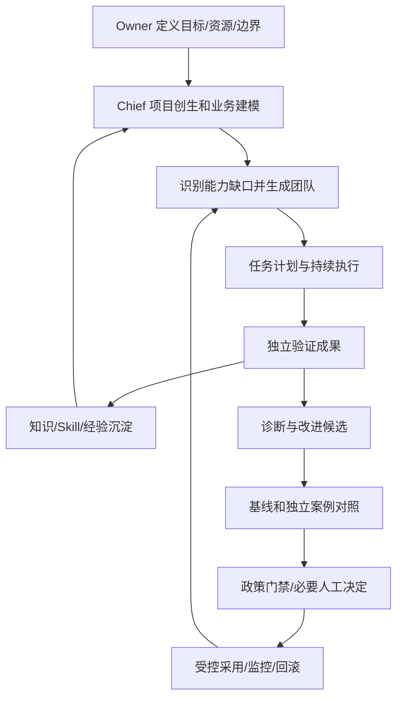
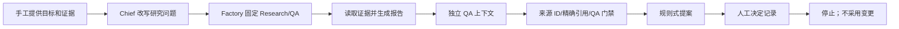

# 原聊天蒸馏与 Porga v0.2 差异审计

审计日期：2026-11-05（Asia/Shanghai）。软件基线为 0.2.0。
本次是原讨论、代码和设计记录的对照，不增加运行时能力，也不更改审批权限。

## 结论

有必要保留原讨论，它记录了项目意图、架构理由和未实现目标。但原文应当作为
本地历史资料保存；经过审阅的设计、需求及差异清单才进入 Git。

不能声称“原讨论都已经实现于 v0.2”。v0.2 是固定 Research/QA 的本地受控内核，
补齐了持久化、恢复和治理；它还不是能够动态组建、持续经营、自主进化组织的平台。
本次提取的 40 项事项已经形成可追溯记录，其中历史建议、未确定选型和未来目标均
明确标记，不能因为被写进文档就视为完成或授权。
随后依据 Owner 的要求，将缺口进一步展开为 [A1 目标架构](../architecture/target.zh-CN.md)、
领域协议、调度/治理、知识/进化闭环和分阶段验收。40 项映射新增设计响应与里程碑，
原有“未实现/部分实现”状态不因架构文档完善而升级。

## 设计主题索引

C01–C05 是用于串联需求的主题编号。本文保留与通用框架相关的设计摘要。

| 来源 | 用户问题/决定 | 原回复的主要内容 | 处理方式 |
|---|---|---|---|
| C01 | 本地 Bot 的联网、数量、两台电脑共用 | 区分定义/实例/记忆；Git 同步配置与中心服务共享状态的差异；本地、远程、云端选项 | 保留边界；历史产品功能不视为当前保证 |
| C02 | AI 自主搭建团队、组织拆分合并、多维递进、24 小时运转、少干预 | 四公理、八维度、六机制、Kernel 权力边界、自治分级、持续运行、评估、阶段路线 | 作为核心愿景与参考设计；逐项核对实现 |
| C03 | 通用框架和领域实例的边界 | L1–L5 五层架构、领域规则与运行时分离 | 保留目标分层和领域隔离 |
| C04 | 名字要好读好记，要求分析报告 | 命名标准、候选比较、推荐 Porga、命名空间/商标检查、品牌独立于模型 | 品牌统一为 Porga；外部可用性未验证 |
| C05 | 确立 Porga 的首个内核交付范围 | 文档、协议、测试、代码与状态隔离 | 本地内核切片已交付 |

用户明确目标、助手给出的参考设计、示例和当前已批准范围必须分开。
例如特定云技术和低风险自动采用政策，不因出现在原助手回复中
就成为已经批准的业务、依赖或权限。

## 40 项事项逐项打印

状态说明：“已实现”只在该行写明的范围内成立；“部分实现”不代表剩余能力已完成；
“设计已保留”不代表有运行代码；命名清查、外部研究等不适合冒充软件功能。

| 编号 | 事项 | 来源 | v0.2 状态 | 实际情况与待补内容 |
|---|---|---|---|---|
| R01 | 品牌与正式定位 | C04/C05 | 已实现 | Porga；Self-Evolving Agent Organization System 已统一。 维持品牌稳定，发布名称另行核验。 |
| R02 | 命名评价与商标/命名空间清查 | C03/C04 | 待发布核验 | 保留易读、易记及可扩展原则。发布前核验适用的命名空间。 |
| R03 | 通用平台与领域实例分离 | C03/C04/C05 | 部分实现 | 通用代码与领域规则分离。后续提供可加载、可验收的领域模板与实例隔离。 |
| R04 | 目标、验证、积累、有界自治四条公理 | C02 | 部分实现 | 章程保留四原则；权限、预算、验证由确定性代码执行。 目标驱动组队、跨任务能力积累仍未落地。 |
| R05 | Generate / Operate / Verify / Evolve 主循环 | C02/C03 | 部分实现 | 有固定团队执行、来源核验和待批提案。 补齐经验反馈、候选实验与版本采用后的下一轮循环。 |
| R06 | L1 Runtime—L5 Projects 五层目标架构 | C03 | 部分实现 | Runtime、Kernel、Organization 和提案层有代码，行业层没有实现。 保留原五层职责；当前流程图不能代替完整目标架构。 |
| R07 | Chief 作为统一入口并按目标规划团队 | C02 | 部分实现 | Chief 只将目标改写为研究问题；强制 research -> qa。 基于需求与能力缺口提出团队/计划，Kernel 校验其边界。 |
| R08 | Project Genesis 六步项目创生 | C02 | 部分实现 | ProjectSpec 只有目标与证据；没有逐项目章程与业务认知模型。 章程、成功标准、风险/资源、假设、停止条件、能力需求、计划与持续调整可追溯。 |
| R09 | 动态 Agent Factory 与丰富 AgentSpec | C02 | 部分实现 | 工厂只能实例化 Research/QA；定义只有角色、版本、能力。 加入用途、输入输出、模型/Skill、评估、生命周期、项目归属及受控候选注册。 |
| R10 | 临时/长期 Agent 与生命周期 | C02/C03 | 未实现 | 没有候选注册、晋升、停用、归档和长期专家状态。 用明确状态转换及测试管理临时 Agent 与持久专家。 |
| R11 | 有依赖的任务规划、调度与协作 | C02 | 部分实现 | 有串行执行、阶段检查点与人工恢复。 增加通用任务依赖、优先级、按需并发和跨角色协作验收。 |
| R12 | 组织拆分、合并、替换、暂停与淘汰 | C02/C03 | 未实现 | 固定两类子 Agent，不能自行重组。 组织候选需质量/成本/协调/安全对照，不可仅凭 Chief 自述采用。 |
| R13 | Evolution Engine 诊断与候选改进 | C02 | 部分实现 | suggest() 按验证是否通过生成两种固定文案。 基于失败、耗时、费用、人工纠正等证据，生成实际可比较的变更候选。 |
| R14 | 基线、独立测试集和真实结果评估 | C02 | 未实现 | evaluate() 只运行六个固定门禁回归，不是新旧 Agent 效果比较。 有未参与优化的案例、基线版本、质量/费用结果和回归判定。 |
| R15 | 采用、灰度、监控与回滚 | C02 | 未实现 | 批准仅写一条决定；deployment 永远为 not_applied。 变更包、评估、授权、版本激活、监控、失败回滚形成受控闭环。 |
| R16 | 八个自主递进维度 | C02 | 设计已保留 | 业务认知、知识记忆、专业能力、效率、协作、组织、决策、创新未形成综合能力系统。 逐维度定义可验证指标，不能拿单元测试通过替代能力提升。 |
| R17 | 六类长期知识/经验对象 | C02 | 部分实现 | 有输入 Evidence、Artifacts、审批 Decisions；并非完整六类知识体系。 实现 Evidence/Fact/Hypothesis/Decision/Skill/Lesson 的可检索持久对象与晋升。 |
| R18 | 记忆来源、可信度、时效、验证和版本 | C02 | 部分实现 | 有证据 ID/标题/原文、成果哈希及审批时间。 增加来源定位、有效期、信任/验证状态、知识版本与过期复核。 |
| R19 | 项目隔离与跨项目知识晋升 | C02 | 未实现 | 证据工具只读本次任务，但没有显式项目级知识权限与平台晋升机制。 不同项目默认隔离；脱敏、授权后才晋升通用经验。 |
| R20 | 业务假设、优先级与方向演化 | C02 | 未实现 | 无商业目标跟踪、实验反馈、转向/停止建议机制。 建议应绑定真实业务证据；改变最终目标或重大敞口仍交给人决定。 |
| R21 | Chief 与确定性 Kernel 权力分离 | C02 | 已实现（本地范围） | 模型不能改权限、预算、审批或持久库；工厂校验、费用限制与人工决定由内核控制。 扩大角色/工具时保持相同边界，并补对应测试。 |
| R22 | L1–L5 分级自治与异常升级 | C02 | 未实现 | 只有本地固定权限与人工批准，没有通用分级授权引擎。 先让所有者明确每级范围，再实施可审计政策；不能把历史建议当作授权。 |
| R23 | 24 小时按事件持续运转 | C02 | 未实现 | CLI 完成一次任务后退出，无定时器、事件监听或常驻 Worker。 持久调度、唤醒、监控、恢复与通知可演练；模型按需调用。 |
| R24 | 持久队列、去重、优先级、超时和重试 | C02 | 部分实现 | 有 request-key 去重、超时、持久状态与显式恢复。 尚无通用队列/优先级/后台 Worker；重试需处理副作用和重复费用。 |
| R25 | 成熟 Runtime 集成与后续适配 | C02/C03 | 部分实现 | 已集成 OpenAI Agents SDK 与离线 Model。 MCP、Codex、其他模型/API 是待评估扩展，不是已安装功能。 |
| R26 | 跨电脑共享 Bot 状态与长期记忆 | C01/C02 | 未实现 | SQLite 与本地文件，Git 不同步运行状态。 引入身份认证、中心状态/知识服务及并发/项目权限后再共享。 |
| R27 | 区分配置、执行实例和记忆；联网与数量边界 | C01 | 部分实现 | 文档区分离线/在线、代码/状态；当前最多两个子 Agent，串行运行。 不得把角色定义数量当并发量；跨设备执行与记忆仍待实现。 |
| R28 | 本地 Git 到私有 GitHub，再考虑公开 | C03/C05 | 部分实现 | 本地仓库、提交、忽略规则与发布前检查已具备；无远端。 用户明确授权后再检查/创建 private 仓库、推送并回读验证。 |
| R29 | 源码/Blueprint 与真实数据、密钥分开 | C01/C03/C05 | 已实现（当前范围） | 仅合成示例；密钥/数据库/日志/虚拟环境被忽略；原聊天本地归档不提交。 后续真实数据和跨项目访问需独立数据政策；私有仓库也不存密钥。 |
| R30 | 六个核心协议 | C02/C05 | 部分实现 | ProjectSpec/AgentSpec/TaskSpec/EvolutionProposal/EvaluationGate/PermissionPolicy 均有类型与 Schema。 字段仍是最小切片，未覆盖完整项目创生、Agent 生命周期、实验采用和知识晋升。 |
| R31 | 长期部署技术栈 | C01/C02 | 待选型 | 当前只有 Python SDK、SQLite、本地文件和 CLI。 Next.js/React、Temporal/队列、PostgreSQL/pgvector、S3、RBAC 等随真实需求评估。 |
| R32 | 多目标指标与三个核心成效指标 | C02 | 部分实现 | 记录部分调用、Token、估算费用、验证结果与人工决定；没有成效看板。 覆盖业务价值、质量、协作、经济性、自治、进化、安全；定义 VBV/HD/VIR 的计算与证据。 |
| R33 | P0–P4 能力阶段与晋级条件 | C02 | 设计已保留 | 当前是 P0 内核切片与运维加固，不能因软件版本 v0.2 就称完成 P2。 每一阶段按验收证据晋级，不按版本号推断能力。 |
| R34 | 首个研究任务与失败后自改进试验 | C02 | 部分实现 | 完成证据受限研究、QA、引用核验与提案。 没有联网取证，也没有失败诊断后改研究方法并独立证明改善的实验。 |
| R35 | 领域模板与跨领域复用 | C03/C04/C05 | 未实现 | 只有未来路线说明。用公开或合成案例验证领域模板、任务链和内核边界。 |
| R36 | 许可证、仓库/组织/包名和公开品牌 | C04/C05 | 待发布核验 | 品牌选定；本地发行名 porga，不代表 PyPI 注册；未选择许可证。 分别核验命名空间；发布前明确许可证与脱敏范围，历史候选无需变为代码。 |
| R37 | ADAS/GEPA 等研究及厂商事实 | C01/C02/C03/C04 | 历史参考，未重验 | 原文与历史引用被本地保留，没有把产品/研究/商标说法当成当前事实。 如将其用于技术决策或公开文章，应重新读取原始来源验证。 |
| R38 | 交付可验证的本地项目 | C05 | 已实现 | 已有本地代码、文档、协议、测试和 Git 提交。 远端同步单独按 R28 验收。 |
| R39 | 尽量少打扰人，必要时才请求决策 | C02 | 未实现 | 每次提案都需人工决定；没有按风险分级自动放行或通知策略。 低风险自治范围需所有者批准后实施，不能借长期愿景自授审批权。 |
| R40 | 个人经营系统、企业平台与组织研发平台 | C02/C03/C04 | 设计已保留 | 长期方向保留；当前只有单人本地内核。 根据验证价值逐步扩展，不宣称已交付三个产品。 |

完整的机器可读映射、来源类型和证据路径见 [requirements.json](requirements.json)。
这些事项的粒度不同，不能据此计算一个有意义的“项目完成百分比”。

## 架构上的实质出入

原讨论的目标分层是：

L5 Projects & Industry Teams -> L4 Evolution Engine -> L3 Organization Engine ->
L2 AOS Kernel -> L1 Multi-Agent Runtime。Owner 位于这些层之上。

审计前的 architecture.md 则把 Owner/Organization/Execution/Kernel/Evolution 列为“五层”。
这能解释本地执行视图，却没有准确保留原讨论的目标分层，行业层也被弱化。
本次已恢复原五层目标与代码映射，同时保留现有执行流程图，明确二者不同。

核心差异不是目录名，而是能力：
- Chief 当前只能请求 research/qa，不能按目标生成不同专业团队。
- Agent Factory 当前是受限模板实例化，不是完整的“AI 设计和创建 AI”。
- 本地 SQLite 持久成果不是带验证、时效和晋升规则的知识/Skill 系统。
- 当前提案只有固定规则文案，不是从轨迹生成实际改进候选的诊断引擎。
- 当前评估是来源门禁回归，不是独立测试集上的新旧组织对照。
- 批准后不采用任何变更，也不存在灰度/回滚和反哺组织的后半环。
- CLI 执行后退出，不是事件队列驱动的全天候经营系统。
- 本地只有可信 OS 用户，没有中心共享状态、项目级知识隔离或多人 RBAC。

## 流程对照

目标流程：

实际 v0.2：

持久化、预算、恢复、去重、取消、备份是第二条流程的可靠性保障，并未补齐第一条
流程中的目标创生、动态组织、知识晋升、候选实验或持续采用闭环。

## 八个递进维度

业务认知、知识记忆、专业能力、执行效率、协作机制、组织结构、决策能力、创新探索。
v0.2 主要增强执行可靠性和部分经济性/治理基础，不能推断其他维度都已提升。

## 六种核心机制

1. 项目创生：章程 -> 业务模型/证据缺口 -> 能力需求 -> 团队 -> 任务计划 -> 持续调整。
2. Agent 工厂：版本化定义、受限权限、评估、注册与生命周期；临时 Agent 与长期专家分开。
3. 组织演化：拆分/合并/替换/停用 -> 质量、费用、协调、安全对照 -> 决定是否采用。
4. 进化引擎：反馈与失败 -> 诊断 -> 候选 -> 独立实验 -> 门禁 -> 采用/监控/回滚。
5. 记忆演化：Evidence/Fact/Hypothesis/Decision/Skill/Lesson 带来源、归属、可信度、时效和版本。
6. 业务演化：检查商业假设和资源优先级；改变最终目标、重大支出或权限需所有者决定。

## 六个协议的差异

| 协议 | 当前切片 | 目标仍缺什么 |
|---|---|---|
| ProjectSpec | goal、evidence | 成功标准、资源、授权、假设、里程碑、停止条件和业务认知 |
| AgentSpec | role、version、capabilities | 身份/项目/用途、输入输出、模型/Skill、评估、候选状态、停用与晋升 |
| TaskSpec | run、role、status、artifact | 通用任务内容、依赖、优先级、验收规则和调度策略 |
| EvolutionProposal | 文案、评估引用、审批状态 | 基线/候选版本、实际差异、实验计划/结果、采用/回滚指针 |
| EvaluationGate | 四项来源/引用/QA 检查 | 独立数据集、业务质量、回归、费用和风险门禁 |
| PermissionPolicy | 固定能力和禁止项、最多两个子 Agent | 按项目/资源/动作/风险的授权、分级自治、异常升级与组织变更政策 |

有同名协议文件不能证明原讨论中的完整协议已经实现。

## 指标、阶段和未来选型

指标分七组：业务成果、任务质量、组织效率、经济性、自主程度、进化质量、安全性。
三个核心指标是 Verified Business Value、Human Dependency、Validated Improvement Rate。
当前只能提供部分计量原料，没有实现完整成效评估或证明自进化率上升。

阶段定义：
- P0 Kernel：受限 Agent、任务/政策/审计的可验证内核；当前只有该阶段切片与运维加固。
- P1 Autonomous Team：按目标形成团队并完成真实任务，尚未完成。
- P2 Learning Organization：知识/Skill 晋升经对照证明提升，尚未完成。
- P3 Adaptive Organization：组织拆分合并与采用带来净收益，尚未完成。
- P4 Autonomous Enterprise：持续业务监控与授权内经营，尚未完成。

Next.js/React、Temporal/自建队列、PostgreSQL/pgvector、S3、MCP/Codex/其他模型、
Tracing 和 RBAC 是原助手提出的可选方案。当前只确定 Python Agents SDK、本地 SQLite、
CLI 和合成示例。开源许可证、外部包名、商标和域名尚未确定；不沿用历史检索作为现状证据。

## 蒸馏之后“融入”了什么

- 已进入运行代码：以原讨论为方向的受限团队执行、确定性权限/预算/存储/引用门禁，
  加上本地审批、恢复、备份等当前切片。
- 本次补入工程记录：原五层目标、八维递进、六机制、知识模型、自治分级的待决性质、
  长期成效指标、阶段验收、行业隔离、所有实现差异与追溯索引。
- 仍只在本地历史中：被淘汰的命名讨论、完整聊天、完整消息标识和未重验的外部引用。
- 尚未进入代码：上表明确列出的动态组织、长期知识晋升、真实改进实验、采用/回滚、
  全天候调度及共享服务。不能将“已备份/已写文档”改称“已经实现”。

本次不增加软件版本号：代码能力仍为 v0.2.0。后续优先顺序应是先补项目/Agent
完整协议与目标驱动团队，再补可追溯知识，随后做一个真实候选的独立对照与受控采用；
全天候服务和领域模板需各自验收，不以搭出空目录代替实现。
