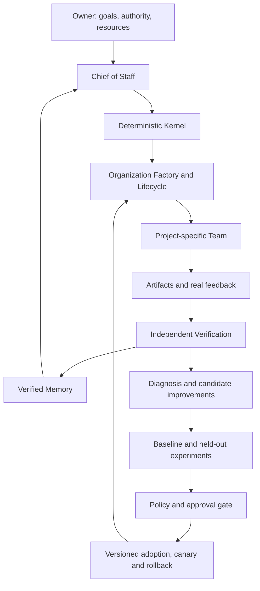

# Porga long-term vision and design boundaries

Status: requirements and reference design, not a claim of implemented capability.
See [source audit and current gaps](design/conversation-audit.zh-CN.md).

## Owner intent and current scope

The owner chose **Porga — Self-Evolving Agent Organization System**. The long-term goal
is to start from a business/project objective, create an appropriate AI team through a
Chief of Staff, operate continuously, retain verified experience, and improve organization,
capabilities and business understanding with minimal routine human intervention.

The owner subsequently selected a **single-user local pilot using public/synthetic data**.
That narrows current delivery; it does not cancel the long-term goal. v0.2 is a governed
research/QA kernel. It has not delivered dynamic organization or validated self-evolution.

## Principles

1. Goals drive organization: add a role only when a demonstrated capability gap warrants it.
2. Independent verification governs acceptance, including baselines and held-out cases.
3. Preserve verified facts, decisions, skills and lessons, including failures and validity limits.
4. Bound autonomy by owner purpose, authority, risk and resources.

Core cycle: **Generate -> Operate -> Verify -> Evolve**. More agents or more proposals
alone do not establish progress. The system must demonstrate increased verified value.
Learning inputs include internal execution evidence and bounded external discovery from
articles, talks, videos and research. Traceable distillation feeds testable hypotheses;
it does not directly activate new system instructions or permissions. See the
[external learning design](architecture/external-learning.zh-CN.md).

## Canonical target architecture

| Layer | Responsibility | v0.2 realization |
|---|---|---|
| L5 Projects & Industry Teams | Domain blueprints and project instances | Goal/evidence input only |
| L4 Evolution Engine | Diagnose, generate candidates, compare, adopt, roll back | Rule-based proposal and human decision only |
| L3 Organization Engine | Chief, Factory, team design, agent lifecycle | Fixed Research/QA templates only |
| L2 Kernel | Tasks, policy, memory, budgets, verification, scheduling | Local state/governance present; semantic memory/scheduler absent |
| L1 Multi-Agent Runtime | Model/tool execution through replaceable adapters | OpenAI Agents SDK and deterministic offline Model |

Owner authority sits above these five layers. The Chief may request changes, while the
deterministic kernel independently enforces policy and resource limits. A future interface
or industry team must not replace or bypass that authority separation.

The diagram is a target design. v0.2 stops after a proposal and a recorded human decision;
the memory/experiment/adoption feedback path is not implemented.

## Six mechanisms from the reference design

1. **Project Genesis:** charter -> business model/evidence gaps -> capability needs ->
   initial team -> dependency-aware tasks -> continuous adjustment or escalation.
2. **Agent Factory:** versioned, evaluated definitions with purpose, inputs/outputs,
   project ownership, tools/skills, permissions, evaluation and retirement. Distinguish
   ephemeral workers from persistent specialists.
3. **Organization Evolution:** propose split/merge/replace/pause/retire changes; compare
   quality, cost, coordination and safety against the current organization before adoption.
4. **Evolution Engine:** diagnose observed failures/results -> candidate change -> independent
   experiments -> gated versioned adoption -> monitor -> roll back when needed.
5. **Memory Evolution:** Evidence, Fact, Hypothesis, Decision, Skill, Lesson with provenance,
   project scope, trust, timestamps, expiry, verification and version. Promote only authorized
   generalized knowledge across project boundaries.
6. **Business Evolution:** revisit business assumptions and priorities with external results;
   changes to owner purpose, material exposure or authority require explicit owner decision.

## Eight improvement dimensions

Business understanding; knowledge/memory; specialist skills/tools/prompts; execution
efficiency; coordination; organization topology; decision quality; innovation/exploration.
Each requires evidence appropriate to that dimension. Better unit-test scores alone do
not demonstrate improved business understanding or organizational performance.

## Continuous operation and autonomy

The target is event-driven operation: scheduler/event listener -> durable priority queue
-> workers -> persistent state/artifacts -> verification and feedback. Models run on
demand, not continuously merely to claim 24-hour availability. Single-host CLI execution
and manual recovery do not provide this continuous service.

The historical assistant proposed L1 observation, L2 bounded execution, L3 bounded
evolution experiments/adoption, L4 preauthorized business operations, and L5 owner-only
material decisions. These tiers are a reference proposal, not an implemented authorization
model or blanket owner permission. v0.2 requires a human decision for every proposal and
does not deploy any proposal. Future low-risk automatic adoption needs explicit policy
and evidence, without allowing an agent to approve itself or alter its own gate.

## Evaluation, knowledge and metrics

Track business outcomes, task quality, coordination efficiency, economic efficiency,
human dependence, evolution quality and safety separately. The three long-term headline
measures are Verified Business Value, Human Dependency and Validated Improvement Rate.
No single composite score should conceal lost correctness or increased risk.

First reference experiment: evidence-backed research plus failure diagnosis, a candidate
research-method change, and an independent quality/cost comparison. v0.2 completes only
the research/provenance/proposal slice; it does not perform the self-improvement comparison.

## Industry and infrastructure boundaries

Domain blueprints keep project-specific workflows and rules separate from generic
organization and governance code. Each project defines its own scope and authority.

Separate agent definitions, active execution instances and memory. Git can version source
and configuration; it does not synchronize live tasks or knowledge across computers.
Future shared state requires an authenticated service and explicit project isolation.

The historical Next.js/React, Temporal/queue, PostgreSQL/pgvector, S3, MCP, Codex and
other-provider suggestions are optional target choices requiring later evaluation. They
are neither dependencies of v0.2 nor obligations to install all components immediately.
Historical vendor-feature, research-paper and trademark claims have not been revalidated
by this reconciliation. Do not turn old chat claims into current implementation guarantees.

## Product and release discipline

Keep the brand independent of a specific model, SDK or industry. A framework, local OS,
hosted platform, research environment and industry applications are possible future forms,
not separately delivered products today. Confirm external package/domain/trademark
availability and choose a license before public release. The local package name `porga`
does not establish ownership of that name on PyPI.

Milestones P0–P4 describe capability maturity; software versions v0.1/v0.2 describe releases.
They are not interchangeable. The current implementation is a P0 kernel slice with local
operational hardening; dynamic P1 team creation and P2–P4 goals remain incomplete.
